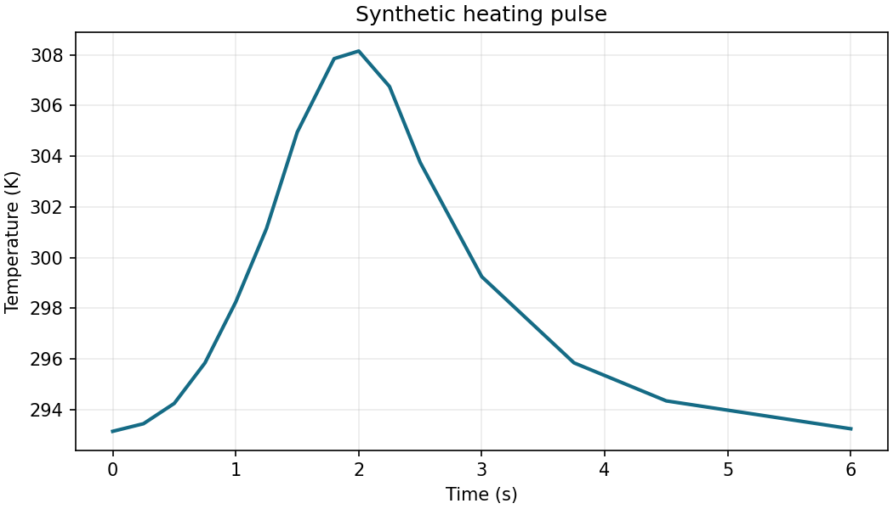

# SSSTrans transient history analysis

Analyze a scalar transient temperature history using plain CSV. The example follows a synthetic bench sensor through a heating pulse and cooldown.

## Run the synthetic demo

Use Python 3.10+ and Matplotlib.

~~~sh
python -m pip install matplotlib
python history.py examples/synthetic_history.csv --title "Synthetic heating pulse"
python -m unittest -v
~~~

The demo writes **build/history.png** and **build/summary.json**. The summary gives the run duration, the first peak and its time, and a time-weighted mean calculated with trapezoidal integration. It supports irregularly spaced samples.

## CSV format

Use one time column named **time_s** or **time_ms** and one temperature column named **temperature_K** or **temperature_C**, in either order. Provide at least two rows with strictly increasing times. The tool converts to seconds and kelvin.

## Relationship to the historical project

The original SSSTrans study collected results across successive simulation runs and plotted the resulting histories. This demo reproduces that analysis workflow on invented measurements. The historical simulation inputs and outputs already present in the repository document the earlier project. The demo has no solver dependency.

## Example output

